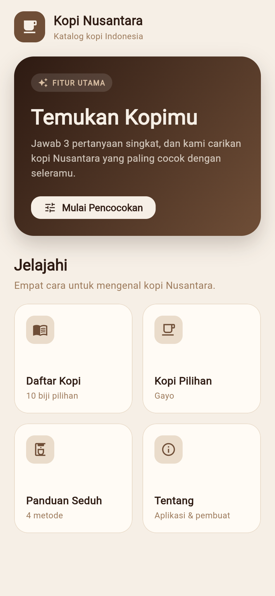
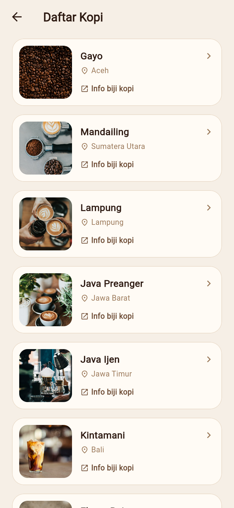
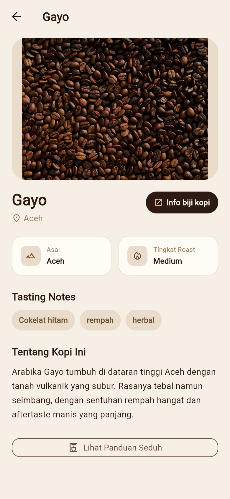
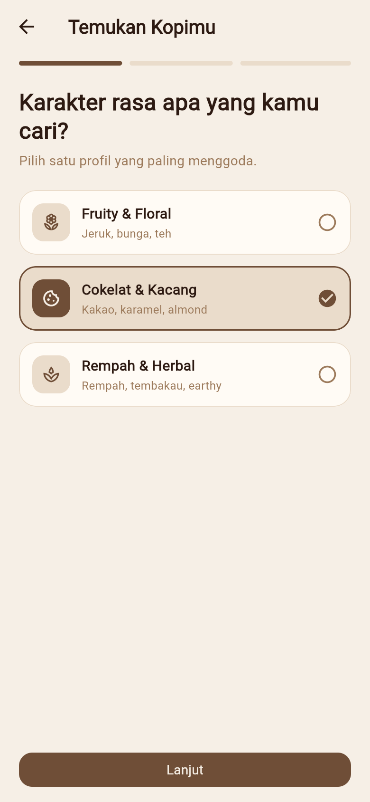
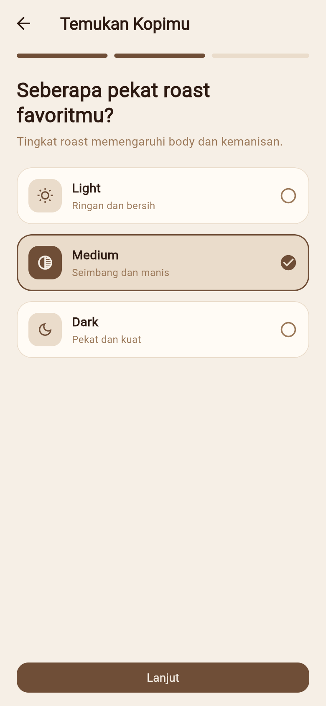
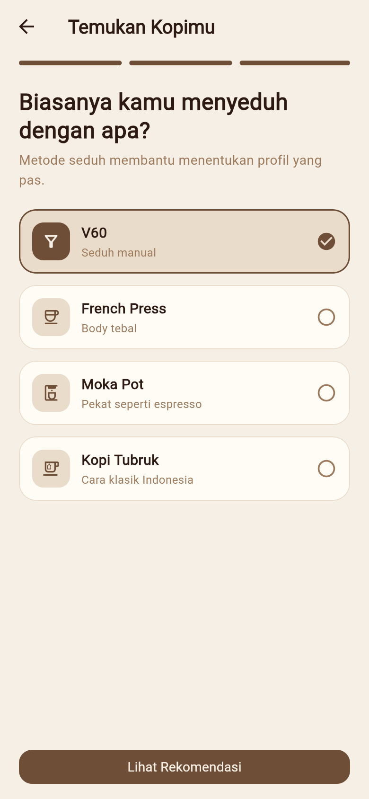
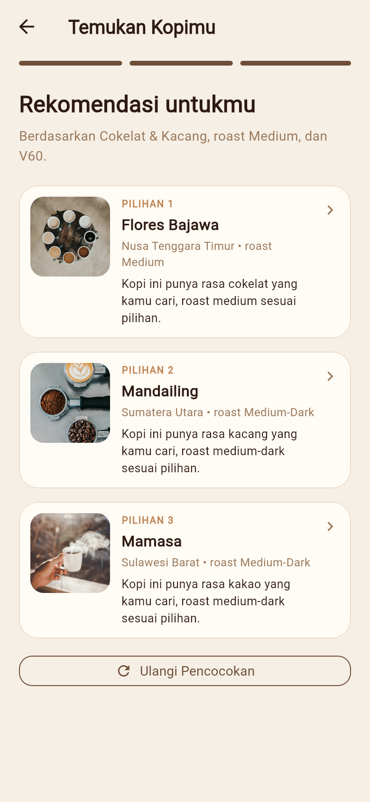
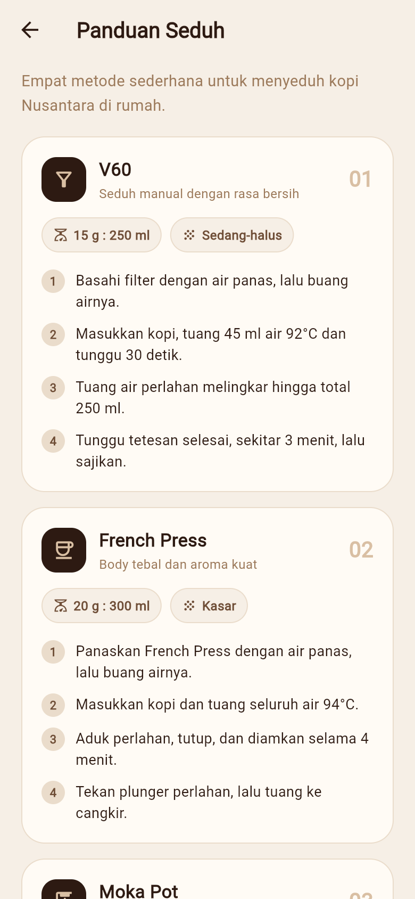
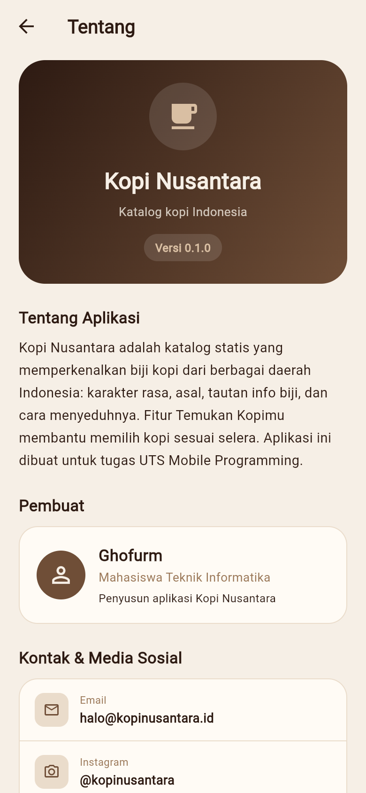

# Kopi Nusantara

Aplikasi katalog kopi Indonesia berbasis **Flutter**. Kopi Nusantara memperkenalkan sepuluh biji kopi dari berbagai daerah Nusantara, mulai dari asal, tingkat roast, karakter rasa, hingga cara menyeduhnya. Aplikasi juga menyediakan fitur **Temukan Kopimu** yang merekomendasikan kopi sesuai selera pengguna.

Aplikasi ini dibuat untuk memenuhi tugas **UTS Mobile Programming**.

## Tujuan Aplikasi

- Menjadi katalog digital yang mengenalkan kopi-kopi khas Indonesia.
- Membantu pengguna memilih kopi berdasarkan preferensi rasa, tingkat roast, dan metode seduh.
- Memberikan panduan seduh sederhana yang bisa dipraktikkan di rumah.
- Menunjukkan penerapan widget, navigasi, pengiriman data, dan tema kustom di Flutter.

Seluruh data kopi masih bersifat **statis** dan disimpan di dalam aplikasi (tanpa backend/API).

## Fitur Aplikasi

### 1. Beranda

Menampilkan identitas aplikasi, banner fitur utama **Temukan Kopimu**, dan empat kartu menu:

- **Daftar Kopi** — membuka katalog lengkap.
- **Kopi Pilihan** — langsung membuka detail kopi pertama (Gayo).
- **Panduan Seduh** — membuka panduan menyeduh.
- **Tentang** — membuka informasi aplikasi dan pembuat.

### 2. Daftar Kopi

Menampilkan **10 biji kopi** dalam bentuk daftar kartu:

Gayo, Mandailing, Lampung, Java Preanger, Java Ijen, Kintamani, Flores Bajawa, Toraja, Mamasa, dan Papua Wamena.

Setiap kartu berisi foto, nama kopi, daerah asal, dan tautan info biji kopi. Mengetuk kartu akan membuka halaman detail.

### 3. Detail Kopi

Menampilkan informasi lengkap satu kopi:

- Foto kopi berukuran besar.
- Nama dan daerah asal.
- Tingkat roast (Light, Medium, Medium-Dark, dan sebagainya).
- *Tasting notes* dalam bentuk chip.
- Deskripsi rasa dan karakter kopi.
- Tautan **Info biji kopi** yang membuka halaman eksternal.
- Tombol menuju **Panduan Seduh**.

### 4. Temukan Kopimu

Wizard tiga langkah untuk mencocokkan kopi dengan selera pengguna:

1. **Karakter rasa** — Fruity & Floral, Cokelat & Kacang, atau Rempah & Herbal.
2. **Tingkat roast** — Light, Medium, atau Dark.
3. **Metode seduh** — V60, French Press, Moka Pot, atau Kopi Tubruk.

Setelah ketiga pertanyaan dijawab, aplikasi menampilkan **tiga rekomendasi teratas** beserta alasan singkat mengapa kopi tersebut cocok. Pengguna dapat membuka detail rekomendasi atau mengulang pencocokan.

Cara penilaiannya sederhana:

- Kecocokan kata kunci *tasting notes* dengan pilihan rasa diberi bobot paling besar.
- Kedekatan tingkat roast kopi dengan pilihan pengguna menambah skor.
- Kecocokan tingkat roast dengan metode seduh yang dipilih juga menambah skor.
- Kopi diurutkan berdasarkan skor, lalu diambil tiga teratas.

### 5. Panduan Seduh

Berisi empat metode seduh lengkap dengan rasio kopi-air, tingkat kehalusan gilingan, dan langkah-langkahnya:

- V60
- French Press
- Moka Pot
- Kopi Tubruk

### 6. Tentang

Menampilkan deskripsi aplikasi, versi, informasi pembuat, kontak/media sosial, serta tombol kembali ke beranda.

### 7. Tautan Eksternal dan Penanganan Error

- Foto dimuat dari internet menggunakan `Image.network`. Jika gambar gagal dimuat, aplikasi menampilkan ikon pengganti.
- Tautan info biji kopi dibuka di browser eksternal menggunakan package `url_launcher`. Jika tautan gagal dibuka, muncul `SnackBar` sebagai pemberitahuan.

## Screenshot Aplikasi

Screenshot diambil dari build web Flutter pada ukuran layar 390 × 844.

| Beranda | Daftar Kopi | Detail Kopi |
| :---: | :---: | :---: |
|  |  |  |

| Temukan Kopimu — Langkah 1 | Langkah 2 | Langkah 3 |
| :---: | :---: | :---: |
|  |  |  |

| Rekomendasi | Panduan Seduh | Tentang |
| :---: | :---: | :---: |
|  |  |  |

## Widget dan Materi Flutter yang Diterapkan

| Materi | Penerapan dalam aplikasi |
| --- | --- |
| `StatelessWidget` dan `StatefulWidget` | Hampir semua halaman berupa `StatelessWidget`; `FindCoffeePage` menggunakan `StatefulWidget` karena menyimpan langkah wizard dan pilihan pengguna. |
| `MaterialApp`, `Scaffold`, `AppBar` | `MaterialApp` di `lib/main.dart` menjadi akar aplikasi; setiap halaman memakai `Scaffold`, sebagian besar dengan `AppBar`. |
| `ThemeData` dan `ColorScheme` | Tema kustom bertema kopi di `lib/theme.dart`: palet warna cream/cokelat, `ColorScheme.fromSeed`, `appBarTheme`, dan `textTheme`. |
| Layout dasar | `Row`, `Column`, `Expanded`, `Padding`, `SizedBox`, `Container`, `Wrap`, `ClipRRect`, `CircleAvatar`, dan `Divider` digunakan untuk menyusun antarmuka. |
| `ListView` dan `GridView` | Beranda memakai `ListView` dengan `GridView.count` di dalamnya; daftar kopi memakai `ListView.separated`; panduan seduh juga memakai `ListView.separated`. |
| Navigasi | `Navigator.push` dengan `MaterialPageRoute` untuk membuka halaman baru, serta `Navigator.pop` untuk kembali. |
| Tombol dan interaksi | `FilledButton`, `FilledButton.icon`, `OutlinedButton.icon`, `IconButton`, `Material`, dan `InkWell` memberikan aksi serta efek ripple. |
| Gambar | `Image.network` dengan `errorBuilder` untuk foto kopi; `BoxFit.cover` dan `BoxFit.contain` mengatur tampilan gambar. |
| State dan reaktivitas | `setState` memperbarui langkah wizard, pilihan, dan hasil rekomendasi secara langsung. |
| Dart 3 | `switch` expression untuk memilih opsi/tahap, serta `.indexed` untuk mengakses indeks saat membangun daftar. |
| Widget kustom | `_MenuCard`, `_FindCoffeeBanner`, `_OptionCard`, `_ResultCard`, `_MethodCard`, `_InfoTile`, dan `CoffeeInfoLink` memisahkan komponen yang dipakai berulang. |
| Aksesibilitas | `Semantics` pada kartu pilihan di wizard menandai elemen sebagai tombol dan menyimpan status `selected`. |
| Package eksternal | `url_launcher` untuk membuka tautan info biji kopi di aplikasi/browser eksternal. |

## Alur Navigasi dan Pengiriman Data

### Struktur navigasi

```
main()
└── KopiNusantaraApp (MaterialApp)
    └── HomePage
        ├── FindCoffeePage ──► CoffeeDetailPage ──► BrewGuidePage
        ├── CoffeeListPage ──► CoffeeDetailPage ──► BrewGuidePage
        ├── CoffeeDetailPage (dari menu "Kopi Pilihan")
        ├── BrewGuidePage
        └── AboutPage
```

Semua perpindahan halaman menggunakan `Navigator.push` dan `MaterialPageRoute`. Tidak ada named route atau state management global; navigasi dibangun langsung dari widget.

### Pengiriman data

Data kopi didefinisikan sebagai objek `Coffee` di `lib/data/coffee.dart`. Objek `Coffee` yang dipilih **dikirim utuh melalui konstruktor** halaman detail:

```dart
Navigator.push(
  context,
  MaterialPageRoute(
    builder: (_) => CoffeeDetailPage(coffee: coffee),
  ),
);
```

Halaman detail menerima data tersebut sebagai field wajib:

```dart
class CoffeeDetailPage extends StatelessWidget {
  const CoffeeDetailPage({super.key, required this.coffee});

  final Coffee coffee;
}
```

Contoh alur pengiriman data:

- **Daftar Kopi → Detail**: item yang diketuk mengirim objek `coffee` dari list statis.
- **Beranda → Kopi Pilihan**: mengirim `coffees.first`, yaitu kopi Gayo.
- **Temukan Kopimu → Detail**: kartu rekomendasi mengirim objek `coffee` dari hasil perhitungan skor.
- **Detail → Panduan Seduh**: tidak mengirim data kopi karena halaman panduan bersifat umum untuk semua kopi.

### Perilaku tombol kembali

- Halaman detail memakai tombol back pada `AppBar` yang memanggil `Navigator.pop(context)`.
- Pada `FindCoffeePage`, tombol back kustom akan kembali ke pertanyaan sebelumnya jika masih di langkah 2 atau 3; jika sudah di langkah 1, halaman akan ditutup.
- Halaman Tentang menyediakan tombol **Kembali ke Beranda** yang juga memanggil `Navigator.pop(context)`.

Tidak ada data yang dikembalikan dari halaman detail ke halaman sebelumnya. Hasil rekomendasi tetap tersimpan selama halaman `FindCoffeePage` masih terbuka, dan akan direset ketika pengguna menekan **Ulangi Pencocokan**.

## Struktur Proyek

```
lib/
├── main.dart                    # Entry point, MaterialApp, dan HomePage
├── theme.dart                   # Palet warna dan tema aplikasi
├── data/
│   └── coffee.dart              # Model Coffee dan 10 data kopi
├── pages/
│   ├── coffee_list_page.dart    # Daftar kopi
│   ├── coffee_detail_page.dart  # Detail kopi
│   ├── find_coffee_page.dart    # Wizard rekomendasi
│   ├── brew_guide_page.dart     # Panduan seduh
│   └── about_page.dart          # Tentang aplikasi
└── widgets/
    └── coffee_info_link.dart    # Tautan info biji kopi (url_launcher)

docs/
└── screenshots/                 # Screenshot untuk README
```

## Cara Menjalankan

Prasyarat: Flutter SDK sudah terpasang.

```bash
flutter pub get
flutter run
```

Menjalankan di browser:

```bash
flutter run -d chrome
```

Build web untuk produksi:

```bash
flutter build web
```

> Aplikasi membutuhkan koneksi internet untuk memuat foto kopi dari Unsplash dan membuka tautan info biji kopi.

## Sumber Data dan Aset

- Data kopi: `lib/data/coffee.dart` (10 entri statis).
- Foto kopi: Unsplash.
- Tautan info: Wikipedia Indonesia.
- Ikon: Material Icons.
- Package: [`url_launcher`](https://pub.dev/packages/url_launcher).

---

Dibuat oleh **Ghofurm** — Mahasiswa Teknik Informatika, untuk tugas UTS Mobile Programming.
